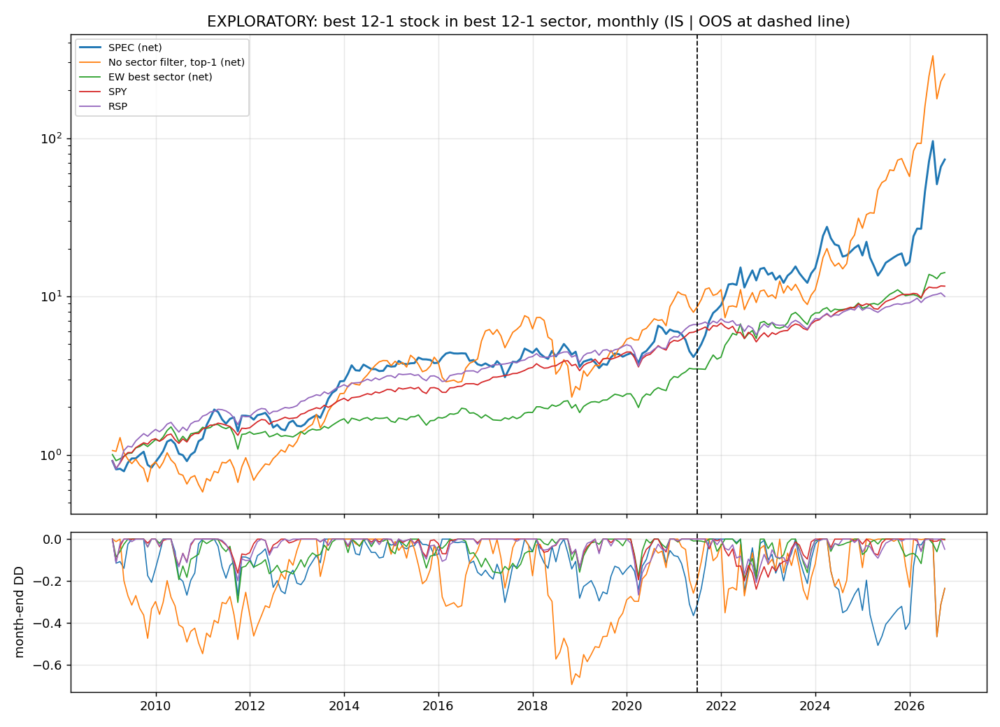

# 动量板块×动量股策略（Momentum Sector × Momentum Stock）

> [!WARNING]
> **探索性回测，不能按"历史股票数据齐全"验收。** 两轮独立审计（内部 + 外部 ChatGPT）的问题已修复并重跑（第 7 节）。
> 仍有 **38 个历史代码 / 0.62% 的"股票 × 月份"** 没有可用数据（第 5 节，逐个列在 `results/gap_ledger.csv`）。
> 外部审计还提供了 Investing.com 等来源的补数包，**尚未接入**（主要补 2018-04 以后的断档）。
> 样本外区间在修复前已被看过，属于**回顾性时间留出**，不是从未接触的样本外。
> **第三轮外部审计（2026-10-29）**：主策略与纯动量账本复核通过；基本面时点、6 个月持仓账本、中小盘考试检查、失败即停、公开文件已修复（`audit/EXTERNAL_AUDIT_3_2026-10-29.md`）。第 10、11、13、14、15 节中受影响的数字以**第 16 节**为准。

## 1. 策略（冻结于提交 `fbc4c51`，见 `FROZEN_SPEC.md`）

每个月最后一个交易日收盘：
1. 每只当时的标普 500 成员计算 **12-1 动量** = P(t−1)/P(t−12) − 1。
2. 每个 GICS 行业（按当时的历史分类）的得分 = 合格成员动量的**等权平均**。
3. 买得分第一的行业里动量第一的**一只股票**，满仓持有一个月。
4. 平手按代码字母排序；成本每边 10bp（按交易前漂移权重）；退市按真实对价或最后成交价处理。

样本：持有月 2009-01 至 2026-09（213 个月）。样本内 IS = 前 149 个月（至 2021-05），样本外 OOS = 后 64 个月。参数网格只用到 2021-04 的数据挑选。

## 2. 结果（扣成本；格式：年化收益 / Sharpe / 月末最大回撤）

| 策略 | 样本内 2009–2021.05 | 样本外 2021.06–2026.09 | 全期 | 全期至 2025 年底 |
|---|---|---|---|---|
| **主策略：最强行业里的最强股票** | **12.1% / 0.53 / −37%** | **71.3% / 1.10 / −51%** | **27.4% / 0.74 / −51%** | **17.9% / 0.62 / −51%** |
| 主策略，次日收盘成交 | 13.7% / 0.56 / −41% | 69.1% / 1.10 / −50% | 28.1% / 0.76 / −50% | 19.1% / 0.64 / −50% |
| 主策略，行业改用 SPDR ETF 动量 | 3.5% / 0.26 / −68% | 31.2% / 0.68 / −58% | 11.2% / 0.42 / −68% | 10.1% / 0.40 / −68% |
| 不选行业：全市场动量第一名 | 18.2% / 0.61 / −69% | 91.4% / 1.23 / −47% | 36.6% / 0.83 / −69% | 26.9% / 0.73 / −69% |
| 最强行业的全部股票等权 | 10.6% / 0.61 / −30% | 30.1% / 0.99 / −19% | 16.1% / 0.74 / −30% | 14.7% / 0.70 / −30% |
| 全市场动量前 10 名 | 9.9% / 0.53 / −34% | 29.8% / 0.82 / −25% | 15.5% / 0.63 / −34% | 11.9% / 0.55 / −34% |
| 最强行业 ETF | 11.1% / 0.66 / −27% | 11.2% / 0.41 / −20% | 11.2% / 0.56 / −27% | 12.8% / 0.65 / −27% |
| 样本内选出的最优参数（6-1 动量、1 行业、3 只股票、等权评分） | 24.3% / 0.99 / −32% | 33.2% / 0.74 / −43% | 26.9% / 0.84 / −43% | 25.2% / 0.92 / −32% |
| SPY（标普 500） | 15.4% / 1.02 / −19% | 13.4% / 0.67 / −24% | 14.8% / 0.91 / −24% | 14.7% / 0.91 / −24% |
| RSP（标普 500 等权） | 16.5% / 0.95 / −27% | 8.0% / 0.34 / −21% | 13.9% / 0.78 / −27% | 13.9% / 0.78 / −27% |

样本外截至 2025 年底：主策略 35.2% / 0.83，SPY 12.8% / 0.63。

## 3. 解读

1. **样本内跑输 SPY。** 年化 12.1% 对 15.4%，Sharpe 0.53 对 1.02，最大回撤 −37% 对 −19%。2009–2020 年的 12 年里有 6 年跑输。
2. **样本外收益高，但非常集中。** 最好的 5 个月贡献了全期对数收益的 44%；全期去掉这 5 个月（改为 0%）后年化 14.4%。主要赢家：NVDA、DVN、SNDK、NFLX、WDC。
3. **"先选行业"看不出增量价值。** 同样只买一只股票，不选行业的版本样本内 18.2%、样本外 91.4%，都更高。配对 bootstrap 中，主策略不如不选行业的重抽样比例：样本内 80%（算术平均差）/ 68%（CAGR 差），样本外 69% / 65%。
4. **参数优化不稳定。** 96 个配置的样本内与样本外 Sharpe 排名相关系数 −0.25；主策略在样本内排第 77/96。
5. **统计显著性有限。** 主策略样本外 alpha t 值（Newey–West）1.92；Sharpe 的 bootstrap 5%–95% 区间：样本内 0.07–1.02，样本外 0.39–1.77。这些是基于已实现序列的重抽样份额，**不是 p 值，也不是未来跑输的概率**。

**结论**：主策略样本内跑输 SPY，样本外的高收益依赖少数极端月份；风险远高于指数。**没有证据表明"先选行业"能提高选股效果。** 证据不支持"稳定 alpha"。

## 4. 防止偷看未来、可重复性

| 检查 | 结果 |
|---|---|
| 截断测试（删掉 C 日之后的价格，从头重建全部流程，C 日之前的选股必须完全一致） | ✅ 4 种配置 × 6 个时间点（2011/2014/2018/2021/2024/2026-01），**0 处差异**；与正式回测共用同一套数据准备 |
| 可重复性（3 个不同的 Python 随机种子） | ✅ 4 种配置的选股完全相同 |
| 选参时点 | 只用到 2021-04，第一笔样本外交易在 2021-05-31 收盘 |
| 冻结记录 | 规则先提交（`fbc4c51`），每次运行存档 `results/runs/*_manifest.json` |
| 基本面 PIT | 每个字段只在自己公布后才返回；TTM EPS 统一拆股口径（AMD、NVDA 回归测试通过） |

## 5. 数据缺口

| 年份 | 缺失比例 | | 年份 | 缺失比例 |
|---|---|---|---|---|
| 2008-12 | 1.8% | | 2018 | 1.3% |
| 2009 | 1.3% | | 2019 | 1.0% |
| 2010–2012 | 0.7–0.8% | | 2020–2021 | 0.6% |
| 2013 | 1.5% | | 2022–2024 | 0.3–0.4% |
| 2014–2017 | 0–0.6% | | 2025–2026 | 0–0.1% |
| **全期** | **0.62%**（107,065 个中缺 659 个；2026-10-29 剔除 LSI 后，原 0.55%） | | | |

| 问题 | 代码（缺失的选股月份） |
|---|---|
| **档案只到 2012-09，之后缺**（11 个） | JCI-OLD（原 Johnson Controls，2012-09..2016-08）、AGN-OLD（原 Allergan，2012-09..2015-02）、BTUUQ（..2014-08）、LIFE（..2013-12）、MOLX（..2013-11）、NYX（..2013-10）、BMC（..2013-08）、CBE（..2012-11）、MEE（2011-04..2011-05）、ATGE、SUN（2012-09） |
| **2018 年 4 月起断档**（10 个） | WRK（2018-04..2024-06）、INFO（..2022-02）、CBS（..2019-11）、STI（..2019-11）、APC（..2019-07）、FOX、FOXA（..2019-02）、NFX（..2019-01）、CA（..2018-10）、MON（..2018-05）— 外部补数包里有 Investing.com 数据，待接入 |
| **完全没有价格**（8 个） | SUNEQ（2008-12..2011-11）、NSM（..2011-08）、MMI（2011-01..2012-04）、RX（..2010-01）、CTX（..2009-07）、CITGQ（..2009-06）、MTLQQ（..2009-05）、UST（2008-12） |
| **身份不可信、已排除**（4 个） | PARA（2022-02..2025-07）、VIAC（2019-12..2022-01）、JCI 标签（2008-12..2010-07，当时 Tyco 还不是成员）、LSI（2008-12..2014-04，所有来源都是 Sovran/Life Storage 的价格；第二轮外部审计发现） |
| **前 12 个月历史不足**（7 个） | CB（2016，并购后改用新证券）、DD（2019-06..2020-05，分拆）、INFO（2017-06..2018-03，Markit 2014 年就上市，历史缺失）、FOX、DOW、SNDK、SOLS（新上市或分拆） |

另有 49 个代码是真正的新上市或分拆，不算缺口（`results/gap_ledger.csv`）。

**更正**：上一版写"免费来源已全部尝试，要补完必须付费"，这个说法不对。外部审计找到了更多免费来源（QSTK 旧 Yahoo 档案、Investing.com 退市证券页面、公司官网 PDF、OptionTradingTips），本版已接入其中三个，缺口从 1.37% 降到 0.55%。

## 6. 数据来源

| 来源 | 用途 | 验证 |
|---|---|---|
| Yahoo Finance | 现存股票、ETF | — |
| Tiingo（免费） | Yahoo 已删除的退市股 | 下载后核对日期覆盖成员时段 |
| Nasdaq Data Link WIKI | 2018 年以前退市、代码被重用的公司 | 与 Yahoo 对比 20 只（`data/raw_wiki/_validation.json`） |
| **QSTK 旧 Yahoo 档案**（GitHub，约 2012 年快照） | 2009–2012 年被收购、代码后来被重用的公司（39 个） | 与 Yahoo 对比 15 只大公司，月收益差异中位数 0.008%（`data/raw_archive/_validation_qstk.json`） |
| optiontradingtips.com 档案 | Cephalon、Massey Energy | 价格未含分红 |
| BNSF 官网历史股价 PDF | Burlington Northern（1995–2010） | 价格未含分红 |
| SEC Financial Statement Data Sets | GAAP 基本面 2009–2026（801 家，不参与本策略） | — |
| fja05680/sp500 + Wikipedia + `data/membership_additions.csv` | 指数历史成员；补回被收购方接手代码而漏掉的原 Johnson Controls、原 Allergan | 每条附依据 |

## 7. 审计与修复（`audit/`、`WORKFLOW_AUDIT.md`）

| 审计发现 | 修复 |
|---|---|
| 收购方接手代码，价格是别的公司（EP、CPWR、DD、CB、JCI、CCE、PARA） | `data/identity_resolutions.csv`（每条附证据）：EP 改用 QSTK 档案，CPWR、DD、CB 改用 WIKI 原公司价格；JCI 标签在 Tyco 入指前排除；PARA 2022–2025 排除；CCE、DD 2019 设价格断点。新增 `identity_check.py`（市值合理性 + 与 WIKI 交叉比对） |
| 成员名单把 Tyco 和原 Johnson Controls、Actavis 和原 Allergan 合并成一个代码 | 原公司以 JCI-OLD、AGN-OLD 补回成员名单（`data/membership_additions.csv`） |
| 行业用了现在占用代码的公司、SEC 行业代码分错、2018/2023 年调整 | Yahoo 行业只在价格确认是同一家公司时使用；`data/sector_overrides.csv` 共 70 条人工核对（含日期和来源；其中 8 条标明"未经网络核实"） |
| ETF 版本平手时结果随机 | 2018 年前电信和科技合并为一个 XLK 行业；排名按"值降序、代码升序" |
| 月中退市被当成正常月底卖出 | 月底价格必须是月底前 5 个交易日内的成交；退市按 `data/exit_resolutions.csv` 的真实对价（HSP、TECO、Andeavor、SCANA）或最后成交价，之后持有现金 |
| WIKI 停更规则用了"下个月的数据" | 已取消 |
| 截断测试和正式回测的数据准备不一致 | 共用同一个函数 |
| 基本面 asof 返回尚未公布的字段；TTM EPS 混用拆股口径 | 每个字段单独控制；每季 EPS 先调到同一口径再相加 |
| 缺口账本把 INFO 当成"新上市" | 上市日期改用所有来源中最早的交易日（含 Tiingo 证券清单） |
| 冻结记录被覆盖；bootstrap 标签不精确；回撤没从初始净值算 | 已修复 |

主策略的变化：初版 → 第一次修复 → 本版（补档案数据）：样本内 4.8% → 15.4% → 12.1%；样本外 87.4% → 71.3% → 71.3%。

## 8. 另测：EPS 增长前 10 名 → 动量最高（`eps_momentum.py`、`results/eps_momentum/`）

可靠的 TTM EPS 数据从 2012 年开始。2012–2025 年：原版（EPS 增长率）年化 3.1%（第二轮审计修复前 6.0%）；稳健版（EPS 变化 ÷ 股价）21.9%（修复前 21.7%）；纯动量第一名 35.4%；SPY 14.9%。EPS 增长率受"基期太低"影响，前 10 名常被基数效应占据。这是在同一段历史上另外测试的想法，数据挖掘风险更高。

## 10. SMA200 过滤 + 机器学习（`ML_SPEC.md`、`ml_features.py`、`ml_pipeline.py`、`sma200_overlay.py`、`results/ml/`）

> 本节部分数字已被第三轮审计修复后的重跑更新，以第 16 节为准。

**流程**：规则先冻结并上传（`0235fc3`）→ 2014–2022 年滚动训练、挑模型 → 选择结果先上传（`eb9380a`）→ 才打开 2023–2026 年考试期，只跑一次。
（2023–2026 年在之前的动量回测中已经看过，属于回顾性考试期。）

**开发期 2014–2022（每月 1 只，扣成本）**

| 模型 | 平均 IC（t 值） | 前 1 名 | 前 1 名 + SMA200 | 前 20 名 |
|---|---|---|---|---|
| 纯动量 | −0.001（−0.05） | 16.9% / 0.57 | 24.1% / 0.73 | 6.5% / 0.38 |
| 多因子等权打分 | −0.004（−0.30） | −2.1% / −0.01 | −2.1% / −0.01 | 6.2% / 0.41 |
| Ridge | 0.005（0.36） | −3.2% / 0.09 | 3.0% / 0.20 | 3.8% / 0.25 |
| **LightGBM 小（被选中）** | **0.017（1.07）** | −1.2% / 0.22 | **26.5% / 0.83** | 5.8% / 0.32 |
| LightGBM 中 | 0.015（0.97） | 15.8% / 0.49 | 7.5% / 0.35 | 5.7% / 0.32 |
| LightGBM 排序 | −0.016（−0.92） | 15.0% / 0.50 | 1.8% / 0.23 | 2.7% / 0.23 |

所有模型的 IC 都接近 0 且不显著；扣除 12 次尝试后的 Deflated Sharpe 概率 0.87（未达 0.95）。

**考试期 2023-01 至 2026-09（只跑一次）**

| 策略 | 年化 / Sharpe / 最大回撤 |
|---|---|
| **机器学习选中的模型（LightGBM 小 + SMA200）** | **13.6% / 0.39 / −45%**（IC −0.03） |
| 纯动量第一名 | 137.1% / 1.48 / −47% |
| 纯动量第一名 + SMA200 | 146.3% / 1.53 / −47% |
| 多因子打分前 20 名 | 23.0% / 1.13 / −12% |
| SPY | 21.7% / 1.28 / −8% |

**2026-10-29 第二轮审计修复后重跑**（规模因子拆股口径、股数披露日、同日多财季取最新、LSI/AGN/CB 身份；见 `audit/EXTERNAL_AUDIT_2_2026-10-29.md`）：开发期各模型的 IC 仍接近 0（最高 0.013，t 0.83）。按冻结规则这次选中 LightGBM 中（原来是小），Deflated Sharpe 概率 0.28。考试期重跑（第二次看同一段历史）：选中模型 + SMA200 年化 **−15.5%** / −0.48；原选中的 LightGBM 小在修复前是 13.6%；SPY 21.7%。结论不变：机器学习失败。上面的表格是修复前的数字，留作记录。

**SMA200 过滤加在现有策略上（2010-01 至 2026-09）**

| 策略 | 不加 | 加 SMA200 |
|---|---|---|
| 纯动量第一名 | 40.0% / 0.88 / −69% | 45.5% / 0.97 / −62% |
| 行业动量（主策略） | 30.0% / 0.78 / −51% | 31.3% / 0.80 / −51% |
| EPS 增长（基期利润率保护）→ 动量 | 16.8% / 0.56 / −56% | 12.7% / 0.46 / −77% |

**结论**：机器学习没有找到比简单动量更好的方法——开发期所有模型的预测力（IC）都接近 0，选中的模型在考试期跑输 SPY。SMA200 过滤对纯动量有小幅改善（主要在 2021 年以后），对 EPS 策略反而有害。另外，同一条 EPS 规则的两种实现有 91% 的月份选股相同，年化却差 7 个百分点：**每月只买 1 只股票的策略对细节极其敏感**。

## 11. 其他组合测试与"爆发股因子"（`composite3.py`、`mom30_roe.py`、`tech_only.py`、`explosive_factors.py`、`explosive_v2.py`、`improve_v3.py`、`risk_report.py`）

> 本节部分数字已被第三轮审计修复后的重跑更新，以第 16 节为准。

以下都是在同一段历史上另外测试的想法，数据挖掘风险逐次累积；"只看科技股"带有事后选择的成分。数字是 2026-10-29 第二轮审计修复后的结果。

| 想法 | 结果（扣成本，全期：年化 / Sharpe / 月末最大回撤） |
|---|---|
| EPS 增长 + 动量 + 利润率改善打分，全市场第 1 名（2012–2026） | 23.6% / 0.64 / −50% |
| 动量前 30 → ROE > 20% → EPS 增长最高（2012–2026） | 12.5% / 0.42 / −65%（2012–2025 仅 4.1%） |
| 科技股：动量第 1 名（2010–2026） | 39.9% / 0.90 / −54% |
| 科技股：三因子打分第 1 名（2010–2026） | 43.5% / 0.99 / −39% |

### 爆发股因子：第二轮外部审计后，**策略不成立**

**定义**：所谓"爆发""暴跌"，是未来 6 个月收益排在同期全部成分股的前 5% 或后 5%，不是固定的涨跌幅。筛选规则（开发期 2012-01 至 2022-06，全市场）：爆发 lift ≥ 1.2、t ≥ 2，并且 爆发 lift ÷ 暴跌 lift ≥ 1.10。这条规则只保证"抓大涨股的比例提高得比抓大跌股更多"，**不保证少抓大跌股**——入选因子的暴跌 lift 全都大于 1。

**第二轮外部审计**（对象：提交 `7f24e9b`；详见 `audit/EXTERNAL_AUDIT_2_2026-10-29.md`）发现：
- 小市值因子用了未来拆股：股价按后来的拆股复权，股数却是历史股数；
- 股数没有按自己的披露日使用；
- LSI 的价格是另一家公司；
- 6 个月标签按"未来有没有价格"删掉了被收购的股票。

我们修复时又查出同日多财季取季随机、AGN 和 CB 的价格与基本面不是同一家公司。全部修复后，按**原门槛**重新筛选，小市值（比值 1.03）和毛利率扩张（1.096）落选，剩下 4 个因子：3−1 动量、6−1 动量、距 200 日均线（连续排名，不是"必须在均线上方"）、EPS 增长。4 个里至少有 3 个可用才打分。

| 组合（扣成本；年化 / Sharpe / 月末回撤） | 开发期 2015–2022 | 2023–2026.09（回顾性留出） | 2015–2026.09 |
|---|---|---|---|
| 科技前 5、波动倒数加权 —— 修复前（六因子） | 21.4% / 0.94 / −29% | 68.9% / 1.50 / −20% | 34.9% / 1.14 / −29% |
| **科技前 5、波动倒数加权 —— 修复后** | **13.2% / 0.61 / −41%** | **49.4% / 1.10 / −32%** | **23.7% / 0.80 / −41%** |
| 科技第 1 名 —— 修复前 | 35.9% / 1.01 / −36% | 81.9% / 1.18 / −37% | 49.1% / 1.05 / −40% |
| **科技第 1 名 —— 修复后** | **0.1% / 0.20 / −61%** | **109.2% / 1.43 / −47%** | **26.6% / 0.67 / −65%** |
| XLK | 16.3% / 0.83 / −31% | 36.7% / 1.33 / −11% | 22.5% / 1.00 / −31% |

**真实风险**（`risk_report.py`，2012–2026.09，日度净值按实际持仓重建）：

| | 年化 | 年化波动 | 月末最大回撤 | **日度最大回撤** | 最好 5 个月占总收益 |
|---|---|---|---|---|---|
| 科技前 5、波动倒数加权 | 23.0% | 27.5% | −40.7% | **−45.2%** | 38% |
| 科技第 1 名 | 28.6% | 48.3% | −65.4% | **−67.0%** | 51%（PLTR 32%、MU 30%） |
| XLK | 21.9% | 18.8% | −31.2% | −33.6% | 25% |

科技前 5（波动倒数加权）的亏损年份：2012、2018、2022；2026 只有 1–9 月。2023–2026 内部分段年化：2023–24 27.9%（XLK 37.8%），2023–25 38.7%（XLK 33.2%），2023–26.09 49.4%（XLK 36.7%）——后段优势主要来自 2025–2026。

**撤回的说法**：
- "只有 2023–2026 年是真正的检验"——2023–2026 在研究中被反复看过，只能叫回顾性留出期。
- "风险和 XLK 差不多"——波动高约 50%，回撤更深。
- "每年多赚约 9 个百分点"。

**结论**：修复以后，这个策略在开发期跑输 XLK；全期年化和 XLK 相当，Sharpe 更低，回撤更深，只有回顾性留出期跑赢。**不适合实盘**，只作为研究记录保留。

**财报公告收益因子**（`earnings_factor.py`，规则事先声明）：开发期抓大涨和抓大跌一样多，没有通过。（把它加进四因子后组合变好，但那是事后观察，不能采用。）另外，很多公司在新闻稿发出 1–7 天后才交 8-K，所以 8-K 日期会晚于真实公告日。

## 12. 扩大股票池：标普 500 ∪ 纳斯达克 100（`ndx_universe.py`、`ndx_expand.py`、`results/ndx/`）

> 本节"四因子"两行是第三轮审计修复前的数字，修复后（五因子）见第 16 节；纯动量和主策略两行不受影响。

**数据**：
- **成分股：** 纳斯达克 100 的历史成分来自 jmccarrell/n100tickers（MIT 许可；按指数生效日记录每次调入调出，2007 年起；原文件放在 `data/nasdaq100_src/`，提交号见 `SOURCE.txt`）。
- **价格：** 标普里没有的约 60 只用 Tiingo / WIKI 补齐（`data/raw_ndx/`），沿用同一套身份规则：价格序列必须在成分期开始时就已存在。改名的公司在 `data/ndx_symbol_map.csv` 里逐条写明证据，例如 CTRP→TCOM、RIMM→BB、VIP→VEON。
- **行业和财务：** 行业用 SEC SIC 代码；SIC 明显和 GICS 不一致的 17 只人工改为 GICS，并标明"未逐个上网核实"。财务数据来自 SEC，其中 19 家外国公司（20-F / 40-F）没有，只能用价格类因子。
- **缺口：** 7 只、146 个成分股月（占纳斯达克 100 成分股月的 0.67%）没有可用价格，见 `results/ndx/gap_ndx.csv`。

**检查**：只放标普成分时，用扩池加载器跑出的选股和冻结的主回测 100% 相同。

| 策略（扣成本；年化 / Sharpe / 月末回撤） | 只用标普 | 标普 ∪ 纳指 100 |
|---|---|---|
| 主策略，样本内 2009–2021.05 | 12.1% / 0.53 / −37% | 6.1% / 0.33 / −44% |
| 主策略，样本外 2021.06–2026.09 | 71.3% / 1.10 / −51% | 87.9% / 1.25 / −47% |
| 主策略，全期 | 27.4% / 0.74 / −51% | 26.0% / 0.69 / −47% |
| 纯动量第 1 名，全期 | 36.6% / 0.83 / −69% | 24.9% / 0.64 / −72% |
| 四因子科技前 5、波动倒数加权，2012–2026 | 23.0% / 0.83 / −41% | 24.7% / 0.86 / −44% |
| 四因子科技第 1 名，2012–2026 | 28.6% / 0.73 / −65% | 22.6% / 0.61 / −79% |
| XLK，2012–2026 | 21.9% / 1.07 / −31% | — |

**结论**：池子变大以后，纯动量和主策略的全期结果反而变差；四因子科技前 5 略好一点，但 Sharpe 仍然低于 XLK。扩池不能救回这些策略。新增的纳指成分里，被选中最多的是 ASML、NXPI、ZS、YHOO、BIDU、TEAM（科技前 5 中约 18% 的名额）。

## 13. 因子体检：47 个因子，哪个真的有用？（`FACTOR_SCREEN_SPEC.md`、`factor_screen.py`、`results/factor_screen/`）

> 本节部分数字已被第三轮审计修复后的重跑更新，以第 16 节为准。

**规则在跑之前写定并提交**（`FACTOR_SCREEN_SPEC.md`，私有仓库 `3916ef0`）。
- **范围：** 标普 500 时点成分，目标是下个月收益。选因子只用形成月 2010-01 至 2019-11，2020 年以后只作回顾参考。
- **新加的因子：** 销售库存比（营收 ÷ 存货）及其变化、存货增速 − 营收增速、资产周转、营收 ÷ 市值、毛利 ÷ 总资产、ROE、应计利润、负债率、增发或回购、股息率、经营现金流 ÷ 市值、资产增速、账面市值比。
- **三种方法：**
  1. 逐个因子算 IC（因子排名和下月收益的相关），扣除"一次测 47 个因子"带来的运气（Romano–Wolf 校正）；
  2. 稳定性选择：反复抽一半的月份跑 LASSO，看因子被选中的比例；
  3. LightGBM 置换重要性：按年份滚动训练，在测试年把某个因子打乱，看预测变差多少。
- **判"有用"的条件：** 校正后显著、10 年里至少 7 年方向一致，并且方法 2 或方法 3 至少一个也认它。

**结果：0 个"有用"，33 个"不确定"，14 个"没用"。**

| 最接近显著的因子（未校正 t 值） | IC 均值 | 校正后 p | 10 年中同方向 |
|---|---|---|---|
| 营收增速加快 `rev_accel`（高=好） | 0.014 | 0.37 | 8 年 |
| 上月收益 `rev_1m`（低=好，短期反转） | −0.026 | 0.54 | 9 年 |
| 研发强度 `rd_int`（高=好；只有约 15% 的股票有这项数据） | 0.029 | 0.56 | 8 年 |
| ROE（高=好） | 0.020 | 0.67 | 8 年 |
| 12−1 动量（高=好） | 0.009 | 1.00 | 6 年 |
| 销售库存比 `inv_turn` / 其变化 `inv_turn_chg` | −0.006 / −0.007 | 1.00 / 1.00 | 6 年 / 6 年 |

LightGBM 在 2015–2019 各测试年的整体预测力（IC）为 0.019、−0.057、0.010、0.025、0.031。

**解读**：在标普 500 大盘股里，没有任何一个因子能稳定预测"下个月平均哪只股票涨得多"，扣掉多次尝试的运气后全部不显著。这和第 10 节机器学习的结论一致（IC 接近 0）。动量的平均预测力也很弱；第 11 节说它"有点用"，是指它能多抓到少数大涨股（分布的尾部），不是能预测平均收益。纯动量单股策略的收益来自少数大涨股，所以收益集中、回撤很深。

## 14. 因子组合体检（`FACTOR_COMBO_SPEC.md`、`factor_combo.py`、`results/factor_combo/`）

> 本节部分数字已被第三轮审计修复后的重跑更新，以第 16 节为准。

单因子体检是逐个判定的，可能漏掉"单个没用、合起来有用"的情况。规则同样在跑之前提交冻结（私有仓库 `78c1211`）。每个组合每月买得分前 10%（约 50 只），扣成本后与"标普成分股等权买入"比较。

**结果：21 个组合，0 个"有用"，1 个"不确定"，20 个"没用"。**

| 家族 | 评估期 | 结果（前 10% 扣成本年化 − 等权年化；IC 的 t 值） |
|---|---|---|
| A 经典组合（8 个：价值+动量、质量+价值、动量+低波动、动量+盈利惊喜、GARP、动量+营收毛利加速、质量+动量+价值、动量+短期反转） | 2010-01 … 2019-11 | −3.7% … +1.1%；t 最高 2.0（动量+短期反转；校正后 p = 0.18） |
| B 机器学习（47 个因子全部放入 Ridge / LASSO / LightGBM，滚动样本外） | 2013 … 2019 | −2.7% … −0.6%；t 最高 0.55 |
| C 数据驱动的交互（扫 2,162 对，用 2010–2015 挑出前 10 对） | 2016-01 … 2019-11 | 搜索期 t 值 3.0–4.4，检验期全部掉到 1.5 以下，其中 2 对方向相反 |

等权买入全部成分股在 2010–2019 年化 14.2%。

**解读**：在标普 500 大盘股里，单个因子、经典组合、机器学习自动组合、自动找交互，四种方法都没有稳定跑赢等权买入。C 家族说明了"挖"因子的风险：一次试几千种搭配，总能找到在某段历史里 t 值很高的组合，换一段时间就消失。

## 15. 找牛股的三条线（`WINNERS_SPEC.md`、`winners_tracks.py`、`results/winners/`；中小盘考试 `winners_holdout.py`）

> 本节部分数字已被第三轮审计修复后的重跑更新，以第 16 节为准。

规则在跑之前提交冻结（私有仓库 `f993bd7`，修订 `285b8b4`、`ae612d5`）。标普 500 上的开发结果（扣成本；年化 / Sharpe / 日度最大回撤）：

| 策略 | 2010–2019 | 2020–2026.09 | 全期 |
|---|---|---|---|
| 纯动量第 1 名（基准） | 19.5% / 0.64 / −73% | 77.0% / 1.16 / −56% | 40.0% / 0.88 / −73% |
| 动量前 5 名 + 崩盘过滤（仓位减半） | 16.0% / 0.80 / −27% | 29.1% / 0.77 / −39% | 21.1% / 0.74 / −39% |
| 动量前 5 名，等权 | 15.5% / 0.77 / −31% | 29.1% / 0.77 / −39% | 20.8% / 0.73 / −39% |
| 暴涨分类模型前 5 名，持有 1 个月（2013 年起） | 16.4% / 0.63 / −43% | 14.8% / 0.45 / −54% | 15.6% / 0.52 / −54% |
| 暴涨分类模型前 1 名（2013 年起） | −22.0% / −0.27 / −92% | 2.2% / 0.31 / −78% | −10.9% / 0.06 / −95% |
| 动量前 5 名 + 200 日线空仓 | 13.5% / 0.80 / −29% | 10.2% / 0.38 / −39% | 12.2% / 0.57 / −39% |
| SPY | 13.4% / 1.03 / −19% | 15.2% / 0.76 / −34% | 14.2% / 0.90 / −34% |

**解读**：
- 直接预测"会不会暴涨"的模型挑出的是高波动股票，前 1 名严重亏损。
- 市场过滤和波动目标都能降低回撤，但年化也同步下降，加 1.5 倍杠杆也没有改善。
- 只有集中持有 1 只的纯动量能到 40%，代价是 −73% 的回撤。

**最终候选**（按事先定的规则选出，并在中小盘考试之前冻结，`f2a1e11`）：暴涨模型前 5 名（持有 1 个月）、动量前 5 名 + 崩盘过滤、暴涨模型前 5 名（持有 6 个月）；纯动量第 1 名作为基准一起考。中小盘考试在 Yahoo 数据下载完成后只运行一次（见 `WINNERS_SPEC.md` 第 5 节）。

## 16. 第三轮外部审计修复后的结果（取代第 10、11、13、14、15 节中受影响的数字）

修复内容：
- 每个基本面特征按它全部输入（含一年前对比值）中最晚的公开日使用，新增基本面截断测试并已通过；
- 6 个月持有改用真实分批账本；
- 日度净值不再编造路径；
- 脚本失败即停。

详见 `audit/EXTERNAL_AUDIT_3_2026-10-29.md`。只用价格的策略（主策略、纯动量、科技纯动量）不受影响。

| 项目（扣成本） | 修复前 | 修复后 |
|---|---|---|
| 机器学习考试期（选中模型 + SMA200） | −15.5% | −7.9%；SPY 21.7% |
| EPS + 动量 + 利润率改善，全市场第 1 名，2012–2026 | 23.6% / 0.64 | 20.6% / 0.58 |
| 科技股三因子第 1 名，2010–2026 | 43.5% / 0.99 | 38.3% / 0.90 |
| 爆发股因子（按原门槛筛选） | 4 个 | 5 个：3−1 动量、6−1 动量、距 200 日均线、毛利率扩张、EPS 增长 |
| 爆发股科技前 5（波动倒数加权），2015–2022 / 2015–2026 | 13.2% / 23.7% | 18.1% / 29.3%（Sharpe 0.97，日度回撤 −36%）；XLK 16.3% / 22.5%（Sharpe 1.00） |
| 47 因子体检 | 0 / 33 / 14 | 0 有用 / 36 不确定 / 11 没用 |
| 因子组合体检 | 0 / 1 / 20 | 0 有用 / 2 不确定 / 19 没用 |
| 扩池（标普 ∪ 纳指 100）：五因子科技前 5，2012–2026 | 四因子 23.0% → 24.7% | 只用标普 27.5% / 0.99 / −29% → 扩池 28.9% / 1.01 / −30%（XLK 21.9% / 1.07） |
| 扩池：五因子科技第 1 名，2012–2026 | 四因子 28.6% → 22.6% | 只用标普 39.0% / 0.91 / −68% → 扩池 41.6% / 0.94 / −68% |

**牛股第 2、3 条线**（年化 / Sharpe / 日度最大回撤）：

| 策略 | 2013–2019 | 2020–2026.09 | 全期 |
|---|---|---|---|
| 纯动量第 1 名 | 23.7% / 0.72 / −73% | 77.0% / 1.16 / −56% | 40.0% / 0.88 / −73% |
| 动量前 5 名 + 崩盘过滤 | 16.1% / 0.80 / −27% | 29.1% / 0.77 / −39% | 21.1% / 0.74 / −39% |
| 暴涨模型前 5 名，持有 1 个月 | 7.8% / 0.37 / −47% | 6.8% / 0.29 / −55% | 7.3% / 0.32 / −56% |
| 暴涨模型前 5 名，持有 6 个月（真实账本） | 11.8% / 0.54 / −48% | 14.7% / 0.48 / −48% | 13.2% / 0.49 / −48% |
| SPY | 14.6% / 1.22 / −19% | 15.2% / 0.76 / −34% | 14.2% / 0.90 / −34% |

**解读**：
- 修正一个日期错误，就能让毛利率扩张重新入选、让爆发股策略从"跑输 XLK"变成"收益略高、Sharpe 持平"，说明这类结果对实现细节非常敏感。
- 暴涨分类模型修复后明显变差，说明修复前的部分表现来自偷看未来的基本面。
- 中小盘考试的冻结候选不变（`f2a1e11`），另按统一区间 2013–2019 排出"事后补充"名单（`results/winners/candidates_supplementary.json`），两份名单都会参加考试，并给出 −30% / −100% 的压力情景（`WINNERS_SPEC.md` 第 5c 节）。

**总体结论（按审计意见修正）**：在这批数据、这些实现、这些区间和检验标准下，尚未验证出稳定的超额收益；"年化 50% 以上并且持续"没有可靠证据。这不等于"已证明基本面、机器学习或先选行业一定没用"。另外，成交口径是月末收盘（另有次日收盘的敏感性测试），尚未测试次日开盘成交。

## 9. 文件

**审计入口：`AUDIT_INDEX.md`**（流水线 → 脚本 → 输入 → 输出、测试、冻结规则、提交时间线、README 各节对应的结果文件）。每个文件的大小和 sha256 列在 `MANIFEST.csv`（由 `build_manifest.py` 生成）。

| 路径 | 内容 |
|---|---|
| `backtest.py`、`historical_sectors.py`、`ticker_aliases.py` | 回测引擎、历史行业、证券身份 |
| `pit_truncation_test.py`、`determinism_test.py`、`test_fundamentals_pit.py`、`identity_check.py`、`identity_screen_earnings.py` | 测试与身份检查 |
| `build_gap_ledger.py` → `results/gap_ledger.csv`、`gap_summary_by_year.csv` | 缺口总账 |
| `fetch_*.py`、`resolve_successors.py` | 数据下载 |
| `build_fundamentals.py`、`fundamentals_pit.py`、`data/cik_validity.csv` | SEC 基本面 PIT 数据库，以及（代码，CIK）配对的有效期 |
| `eps_momentum.py`、`ml_*.py`、`sma200_overlay.py`、`composite3.py`、`mom30_roe.py`、`tech_only.py`、`explosive_*.py`、`improve_v3.py`、`earnings_factor.py`、`risk_report.py` | 各种另测 |
| `build_ndx_membership.py`、`fetch_ndx_*.py`、`ndx_*.py` | 纳斯达克 100 扩池 |
| `logs/` | 所有运行日志 |
| `audit/` | 审计记录（`INTERNAL_AUDIT_2026-10-28.md`、`WORKFLOW_AUDIT.md`、`EXTERNAL_AUDIT_2_2026-10-29.md`、`before_tiefix/` 修复前结果副本） |
| `FROZEN_SPEC.md`、`ML_SPEC.md` | 冻结规则 |

复现：`./run_final.sh`（截断测试、可重复性测试、回测、缺口账本、EPS 另测，约 6 分钟）；`./run_postaudit2.sh`（全链条，包括 ML 和爆发股因子，约 10 分钟）。重新下载数据需要在 `.env` 设置 `TIINGO_API_KEY`、`NASDAQ_DATA_LINK_API_KEY`（不在仓库中）。

## 修订记录
- 2026-10-28 初版（`ba751e7`）。
- 2026-10-28 两轮审计后修复，规则先冻结（`fbc4c51`），重跑（`3570fd1`）。
- 2026-10-28 接入 QSTK、OptionTradingTips、BNSF 免费档案；补回原 Johnson Controls、原 Allergan；修正"免费来源已用尽"的错误说法；缺口 1.37% → 0.55%。
- 2026-10-29 第二轮外部审计（对象 `7f24e9b`）后修复：规模因子拆股口径、股数披露日、6 个月标签处理并购退出、同日多财季取最新、LSI 剔除、AGN/CB 配对有效期；新增财报日期身份检查、日度风险报告。主策略选股 100% 不变；爆发股策略结论撤回（见第 11 节）；ML 仍失败。
- 2026-10-29 新增纳斯达克 100 扩池（第 12 节）、`AUDIT_INDEX.md`、`MANIFEST.csv`；运行日志统一放到 `logs/`，审计文件放到 `audit/`。
- 2026-10-29 因子体检（第 13 节）：规则先冻结（`3916ef0`）再跑；47 个因子里 0 个通过。
- 2026-10-29 因子组合体检（第 14 节）：规则先冻结（`78c1211`）再跑；21 个组合里 0 个通过。
- 2026-10-29 找牛股三条线（第 15 节）；最终候选在中小盘考试之前冻结。
- 2026-10-29 第三轮外部审计后修复（第 16 节）：基本面逐字段时点 + 基本面截断测试、6 个月真实账本、失败即停、公开仓库补齐结果文件；只用价格的策略不变。
