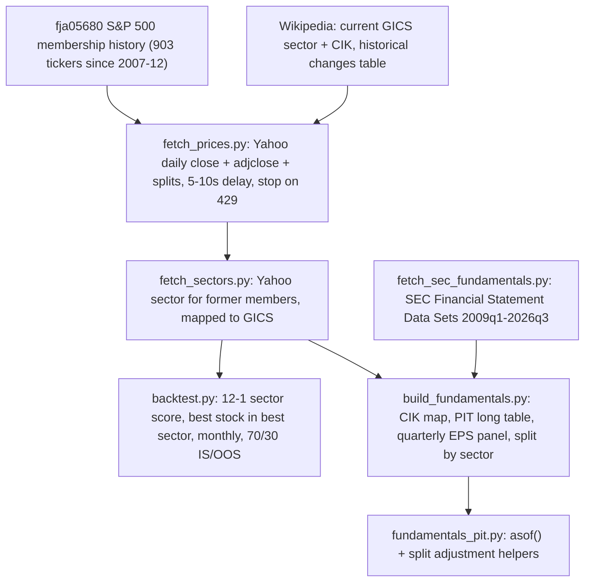

# Workflow Audit — Sector/Stock Momentum Backtest + PIT Fundamentals

Folder: `research/sector_stock_momentum/` (new; no existing project files modified)

## 1. Pipeline

| Step | Script | Status |
|---|---|---|
| Membership + sector + CIK reference files | inline download | Done |
| Yahoo prices (916 symbols) | `fetch_prices.py` | Running (~140/861) |
| Yahoo sectors for former members | `fetch_sectors.py` | Queued (auto-starts after prices) |
| SEC GAAP fundamentals | `fetch_sec_fundamentals.py` | Done (71 quarters, 0 parse warnings) |
| PIT fundamentals store | `build_fundamentals.py` | Built; rebuild after sectors finish |
| Momentum backtest | `backtest.py` | Engine tested on partial data; final run pending |
| Report | `REPORT.md` | Pending |

## 2. Backtest design

- **Universe:** point-in-time S&P 500 members with a price and a sector at month-end t.
- **Signal:** 12-1 momentum = P(t-1) / P(t-12) - 1.
- **Sector score:** (a) equal-weight mean of members' 12-1 (main), (b) SPDR sector ETF 12-1 (robustness).
- **Trade:** hold the single top stock of the top sector from close t to close t+1.
- **Costs:** 10 bp per side on turnover; gross and net reported.
- **Split:** 213 holding months 2009-01 to 2026-09 → IS 2009-01..2021-05 (149), OOS 2021-06..2026-09 (64).
- **Benchmarks:** SPY, RSP, best-sector ETF, EW best sector, top-1 / top-10 stocks without sector filter.
- **Parameter grid (IS only):** lookback {3,6,9,12} × sectors {1,2,3} × stocks {1,3,5,10} × score {ew, etf} = 96 configs; IS-best evaluated once on OOS.
- **Metrics:** CAGR, vol, Sharpe (rf = 3M T-bill), maxDD, hit rate, alpha/beta/t vs SPY, calendar-year returns, full pick log.

## 3. Point-in-time controls already in place

| Risk | Control | Verified |
|---|---|---|
| Buying stocks before they joined the index | Monthly membership filter | Yes |
| Ticker re-use (FB, CSRA, BBT, PARA) | Price used only inside membership window; CIK overrides with name/date checks | Yes (7 overrides) |
| Fundamentals used before public | `available_date` = SEC filing date + 1 day | 0 violations |
| Values dated after their filing | Dropped (PRGO case) | 0 remaining |
| Restatements | First report used; revisions stored separately | Yes (FE example) |
| Stale 2008-10 quarters | `asof(max_age_days=200)` | Yes |
| EPS vs price share basis | Split factor after filing date | Needs split backfill (in progress) |

## 4. Known gaps / possibly neglected (to address or disclose)

| # | Item | Impact | Plan |
|---|---|---|---|
| 1 | Former members Yahoo no longer carries (≈80-100 names) | Survivorship: missing losers inflates results | Report coverage %, disclose |
| 2 | Delisting mid-month with no price | Return set to last price or 0 | Count occurrences in pick log |
| 3 | Sector labels are today's GICS, not historical | Sector look-ahead (e.g., 2018 GICS reshuffle) | Disclose; ETF-score variant as check |
| 4 | Membership file ends 2026-08-18 | Sep 2026 changes missing | Apply Wikipedia changes after that date |
| 5 | Execution at same close as rebalance | Mild optimism | Add next-day-close variant |
| 6 | 96-config grid → multiple testing | IS-best Sharpe overstated | Report IS/OOS rank correlation + deflated Sharpe |
| 7 | Single-stock strategy is very noisy | Wide uncertainty | Add bootstrap confidence interval |
| 8 | SEC filing date lags earnings release by 2-4 weeks | Fundamentals conservative / stale | Disclose |
| 9 | Q4 = FY − 9M; quarterly EPS not exactly additive | Small EPS errors | Disclose (JPM 2012: 5.31 vs 5.20) |
| 10 | Bank / insurer revenue uses different tags | Revenue gaps in Financials | Check coverage per sector |
| 11 | Yahoo glitches (EA, AVB returned 1 day) | Missing names | Re-fetch at end |
| 12 | `adjclose` is dividend-adjusted retroactively | Fine for returns, not for price levels | Use `close` for P/E |

## 5. Operational notes

- **Yahoo load today:** ~916 + ~139 split backfill + ~400 sector lookups, strictly sequential, 5-10s apart, auto-stop on HTTP 429. Runs finish before the dashboard's 04:00 ET live window.
- **Disk:** freed 2.8 GB → ~21 GB. SEC zips deleted after processing; raw price cache (`data/raw/`) and SEC extracts (`data/fundamentals/sec_raw/`, 257 MB) are git-ignored.
- **Git:** commits contain only `research/sector_stock_momentum/`. I did not use `git add .` because the repo has unrelated pending changes (`csv/fred/*.csv` written by the dashboard server) that I should not commit on your behalf.
- **Remaining steps:** finish downloads → re-fetch EA/AVB → final sector rebuild → backtest → audit every monthly pick → `REPORT.md` → commit.
