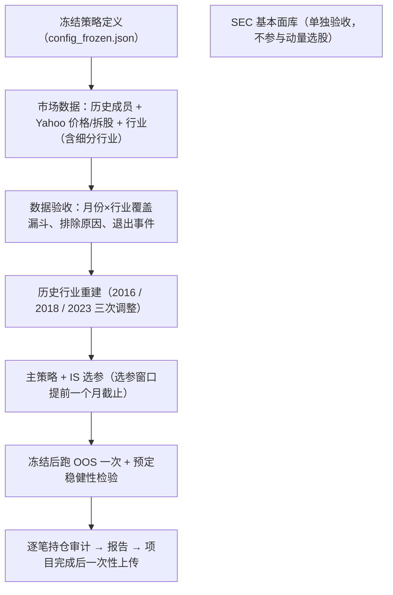

# 工作流程审计（第二版，按外部审计意见修订）

**结论定位：基于免费可得数据的「探索性回测」，不是「已验证的 PIT 回测」。**
原因：退市股票价格和历史行业分类，用免费数据无法完全修复。

## 1. 流程

## 2. 冻结的策略定义（看最终结果之前定下）

| 项目 | 定义 |
|---|---|
| 信号 | 12-1 动量 = P(t-1)/P(t-12) − 1 |
| 行业得分 | 主版本：当月合格成员动量的等权平均（这是"成员动量均值"，不是"行业组合收益"）；对照：当时已存在的行业 ETF 动量 |
| 选股 | 前 n_sec 个行业，**每个行业**选前 n_stk 只；不足就全拿 |
| 权重 | 所有入选股票等权；永远满仓，所有行业动量为负时也不持现金 |
| 合格条件 | 当月是成员 ∧ 当月有价格 ∧ 有完整 12-1 窗口 ∧ 当时的行业可确认。入指前的历史价格照常使用，不要求 t+1 有价格 |
| 退出 | 到 t+1 一律卖出，即使中途被剔出指数 |
| 成本 | 10bp × Σ\|目标权重 − 交易前漂移权重\| |
| 样本 | 持有月 2009-01 至 2026-09（213 个）；IS 149 个月，OOS 64 个月；**选参只用到 2021-04** |
| OOS 规则 | 主策略和 IS 最优配置只测一次；全网格排名相关只作为事先声明的诊断 |

## 3. 外部审计意见逐条处理

| 意见 | 状态 |
|---|---|
| 覆盖率要做成月份×行业漏斗 | ✅ 已做：`coverage_funnel_by_month.csv`、`eligible_by_month_sector.csv`、`missing_members.csv`（含排除原因） |
| 退市缺价不能统一填 0 或末价 | ✅ 改为：有月内最后成交价→用它并记录；完全无价→标为「未解决」，另跑 −30% 和 −100% 压力情景；人工查到的结果放 `exit_resolutions.csv` 优先使用 |
| 历史行业不能用今天的 | ✅ 部分修复：按细分行业重建 2016/2018/2023 三次大调整；其他个别调整无法重建，结论中写明 |
| ETF 成立日期（XLRE 2015、XLC 2018） | ✅ 只用当时已有完整 12 个月历史的 ETF；2018 年前电信股对应 XLK |
| 入指前价格不能截掉 | ✅ 代码本来就正确（成员资格只决定能否买） |
| 不能因没有 t+1 价格而剔除 | ✅ 代码本来就正确 |
| 选参与 OOS 首笔交易同一收盘 | ✅ 已改：选参窗口提前一个月截止 |
| 次日收盘执行要买卖一致平移、基准同区间 | ✅ 已改 |
| 2026-08-18 之后的成员变更 | ✅ 文件结束后所有变更按生效日期补上，并记录在冻结配置中 |
| 成本用交易前漂移权重 | ✅ 已改 |
| 无风险利率口径 | ✅ DGS3MO 是收益率口径（不是贴现报价），改为 (1+y)^(1/12)−1 |
| Alpha t 值 | ✅ 改用 Newey–West（滞后 3） |
| Bootstrap | ✅ 改为配对的 stationary bootstrap（策略、无行业过滤版本、SPY 用同一批抽样月份） |
| Deflated Sharpe | ✅ 全用月度口径；试验数按「不同收益序列」去重；加入偏度、峰度 |
| 行业筛选有没有增量价值 | ✅ 同月份、同股票数、同成本下比较「有/无行业过滤」，含配对 bootstrap |
| 回撤口径 | ✅ 分开报「月末最大回撤」和「日频最大回撤」 |
| 收益集中度 | ✅ 报告前 5 个月、前 5 只股票的贡献，以及去掉最好 5 个月后的 CAGR |
| 可复现性 | ✅ `config_frozen.json` 记录 git 版本、数据快照哈希、依赖版本、数据来源 |
| 下载流程要看状态 | ✅ 行业下载只在价格下载完整结束时才运行（被 429 中断不会继续） |
| SEC 2009Q1 无数据、比较期数据不是当时已知 | ✅ 首次出现日期按实际申报日；陈旧度过滤 |
| segments / 单位 / 多候选值 | ✅ 只留合并数；按单位过滤（顺便发现并剔除了 CAD/EUR/CNY 计价的数字）；同一事实多个不同值→排除并输出清单（目前 0 条） |
| ddate 是取整到月末的日期 | ✅ 容差改为 16 天；剔除的 169 条全部输出到 `dropped_future_dated_values.csv` |
| Q4 EPS 不能冒充公布值 | ✅ 公布 EPS 列只放真正公布的季度值；Q4 和 TTM EPS 放在 `*_approx` 列 |
| EPS 与价格的每股口径 | ✅ 首报 EPS ÷ 申报日之后的拆股，和 Yahoo 拆股调整价同一口径，只调整一次；待拆股数据补齐后用 AAPL（2020 年 4:1）、NVDA 验证 |
| 基本面不能偷偷进入选股 | ✅ 动量主回测完全不使用基本面 |

## 3b. 追加修复：证券身份（审计第 4 点）

| 问题 | 处理 |
|---|---|
| **改代码的公司**被当成缺失（MMC→MRSH、FB→META、ANTM→ELV 等），Yahoo 只在新代码下保留全部历史 | ✅ `ticker_aliases.py`：旧代码使用新代码的完整价格和行业。只有在有身份证据时才合并（同一个 SEC 公司编号，或 Wikipedia 显示新代码早已在指数里），另有 7 个人工核实的改名。不能证明的全部列入 `ticker_aliases_rejected.csv` |
| **旧代码被别的公司重新使用**（FB 现在是另一只证券；ABI、CSRA、APC 等） | ✅ `price_integrity.csv`：价格序列在超过 30 天的空档处切开，只保留和成员时段重叠的那一段；完全不重叠的直接丢弃 |
| **同一代码前后是两家公司**（新旧 CEG、DOW、DELL；KG、GENZ 的价格不属于原公司） | ✅ 逐个成员时段检查：只有在时段开始时价格序列已经存在，这个时段才可信，否则排除。清单在 `membership_spells_excluded.csv`，漏斗表里单列原因。代价：2019 年拆分后的新 Fox（FOX/FOXA）和 2020 年后的新 IR 也被排除（宁可少，不可错） |

## 3c. 截断测试（"假装现在是 C 年"）

`pit_truncation_test.py`：分别假装现在是 2011-06、2014-12、2018-03、2021-04、2024-06，删掉之后的全部价格，从头重建整条流程（价格清洗、改名对应、成员时段可信度、行业、信号），再重新选股。C 之前的每一个选股结果，都必须和用全部数据时完全一样。

| 轮次 | 结果 |
|---|---|
| 第 1 次 | ❌ 不通过：356 处不一样。原因是清洗价格时，用"和成员时段重叠最多"来挑选价格片段，这一步用到了未来的数据；改名公司的新代码也因此在早年被误删 |
| 修复 | 改为保留所有和成员时段重叠的片段（不再挑"最好的一段"）；改名公司按新旧代码的成员时段合并判断；动量和持有期收益都不能跨越价格空档（空档两边可能是两只不同的证券） |
| 第 2 次 | ✅ 通过：3 个配置 × 5 个截断日期，0 处不一样 |

说明：测试截断的是价格。成员名单、改名关系本身就是按日期记录的历史，用它们识别"同一只证券"属于身份识别，不提供收益信息。全部数据下载完后会再跑一次。

## 4. 无法用免费数据修复的（结论必须降级）

1. **Yahoo 已经查不到的历史成员**：影响选股，也影响行业均值和排名，方向和幅度未知。漏斗表会给出每月具体缺多少只。
2. **退市的真实收益**：只能对实际持有过的股票逐笔查，查不清的标为未解决，并跑压力情景。
3. **三次大调整以外的个别行业变动**：无法重建。
4. **证券身份**：CIK 对应的是申报公司，不对应具体股票类别。目前用 ticker + 成员时段 + 人工核对处理，不保证完全正确。

## 5. 最终报告前的验收清单

- [ ] 价格下载完成且未被 429 中断；补拆股；重新下载 EA、AVB
- [ ] 行业下载完成；历史行业重建覆盖所有入选股票
- [ ] 覆盖漏斗：列出每月合格比例最低的月份及原因
- [ ] 每一笔实际持仓：买入、退出价格可追溯；所有非正常退出逐笔列出
- [ ] AAPL / NVDA 拆股口径验证
- [ ] 冻结配置写入后再看 OOS 结果
- [ ] 报告标题与结论使用「探索性回测」措辞
- [ ] 项目完成后一次性提交（只含本文件夹 + 规则文件改动）
